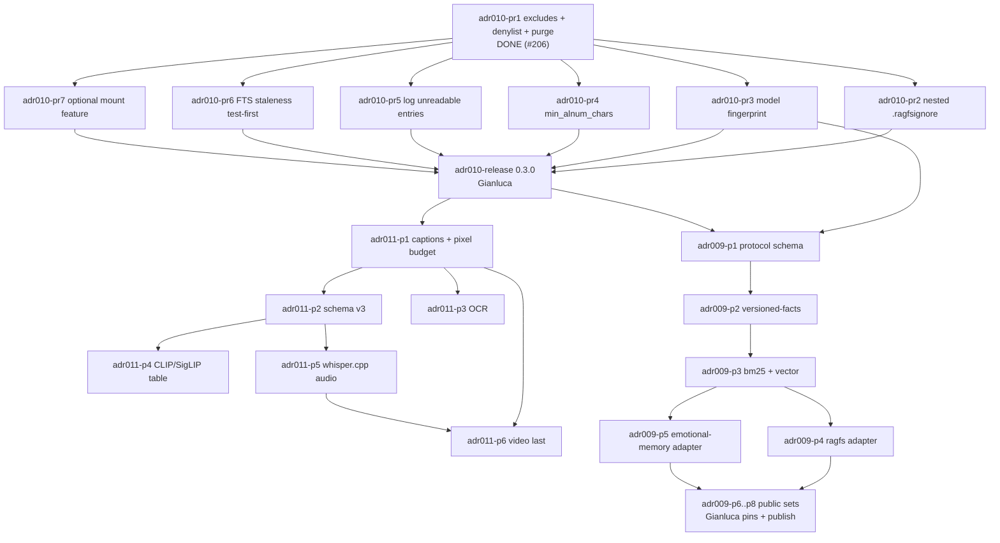

# RAGFS completion plan

This file is the **single completion plan** for work accepted on `main`. It does
not implement that work. Source of truth for design is
[`docs/ARCHITECTURE_DECISIONS.md`](ARCHITECTURE_DECISIONS.md). If this file and
an accepted ADR disagree, **the ADR wins**.

This document was created because no `docs/ROADMAP.md` existed on `main`
(`0ef60e0b`). It records accepted ADRs and the sequenced PRs that follow them.
It does not assign calendar dates. Size figures are rough order-of-magnitude
only (not measurements).

**Implementation baseline (updated 2026-10-20):**

- Workspace version: `0.3.0` (`Cargo.toml` `[workspace.package]`).
- Default CLI features: `candle` + `lancedb` + `mount`. `full` adds `vision`.
  `ragfs-fuse` and `fuser` are optional through the default-on `mount` feature.
- LanceDB pin: `lancedb = "0.37.1"` (workspace `Cargo.toml`; 0.38.0 skipped on
  purpose). The shared exclusion matcher uses the `ignore` crate.
- `docs/community-forks.md` records adapted and deferred fork ideas.

Tracked on the [milestones](https://github.com/gianlucamazza/ragfs/milestones) page.

| Status | Meaning |
|--------|---------|
| Done | Landed on `main` |
| In progress | Another agent or PR is already doing this item |
| Not started | Sequenced, not started |
| Unscheduled | Accepted as a later/optional phase; do not start until the maintainer asks |

**Gates:** `CoS merge` = normal review/merge. `Gianluca` = maintainer-only
(release, publishing any benchmark number, new heavy deps or model downloads,
and anything an ADR reserves for the owner).

---

## Contents

- [Shipped](#shipped)
- [Milestone `0.3.0`](#milestone-030) (ADR-010)
- [Milestones for ADR-011 (multimodal, after 0.3.0)](#milestones-for-adr-011-multimodal-after-030)
- [Milestones for ADR-009 (benchmark harness)](#milestones-for-adr-009-benchmark-harness)
- [Deferred (accepted as out of sequence)](#deferred-accepted-as-out-of-sequence)
- [Critical path](#critical-path)
- [Needs maintainer decision](#needs-maintainer-decision)

---

## Shipped

Mark these done so the plan does not re-open them.

| Item | Status | Evidence on `main` |
|------|--------|--------------------|
| ADR-001…007 (Candle, LanceDB, propose-review-apply, FUSE, registries, Blake3, Tokio) | Done | Implemented product path |
| ADR-008 index revision sidecar + opt-in query receipts | Done | `#162` / `e78f01b`; `CHUNKS_SCHEMA_VERSION` stays 2 |
| v0.2.2 release | Done | `#163`, code `bcb1611` |
| MCP hardening in 0.2.2 (allowlisted roots, opt-in writes, caps, annotations, error codes, stderr audit, stdio-only docs) | Done | `#166`–`#172` |
| Directory-scoped search (SemPOSIX idea, already on `main`) | Done | `#60`; ADR-010 does not re-port it |
| ADR-009 Accepted (design only; harness not implemented) | Done (phase 0) | `#165` / `57037b3` |
| ADR-010 Accepted (design only) | Done (ADR PR) | `#175` / `e310209c` |
| ADR-011 Accepted (design only) | Done (phase 0) | `#177` / `0ef60e0b` |

The generated 0.2.3 PR #176 is closed as superseded. Release preparation is
#208 for **0.3.0**, following the breaking ADR-010 changes.

---

## Milestone `0.3.0`

**ADR-010: Index Exclusion, Secret Handling, and Store Integrity.** Security first.
#206 implements PR 1; #207 consolidates the remaining bounded integrity tasks
with separate acceptance tests and issue links; #208 contains only release edits. Target release **0.3.0**. Content-level secret scanning
and `$RAGFS_CONFIG_DIR/ignore` stay deferred (see [Deferred](#deferred-accepted-as-out-of-sequence)).

Where fork code is adapted, the implementing PR uses trailer
`Co-authored-by: sophie4869 <sophie4869@users.noreply.github.com>` and names
the source commits in that PR body. ADR-010 PR 8 (community-forks credits) is
**folded into PR 1**, not a separate PR.

### adr010-pr1 — `fix(index)!: exclude hidden paths and secret files by default`

| Field | Value |
|-------|--------|
| Status | Done — #206, `9bc1bfd` |
| Issue | (#179) |
| Size | L (~800–1500 LOC, mostly matcher + CLI/MCP/FUSE tests) |
| Gate | CoS merge |
| Feature flag | none (new product defaults) |
| Depends on | none (first implementation PR) |

**Scope**

- One shared exclude module (illustrative name `ragfs_index::exclude`) consumed
  by `IndexerConfig::default()`, `config.rs` `default_exclude()`, FUSE mount
  indexing, and `docs/CONFIGURATION.md` / `docs/USER_GUIDE.md`. MCP does not
  walk files; test it against the same index the CLI wrote.
- Use the `ignore` crate (`WalkBuilder` + `OverrideBuilder`). Do not extend the
  hand-rolled `path_matches_pattern` except as a migration shim.
- Hidden files **and** hidden directories excluded by default: any path
  *component under the index root* that starts with `.`. The index root itself
  may be hidden (`~/.notes`); do not exclude the root, only descendants.
- Watcher uses the same matcher (drop the basename-only `.` shortcut).
- Secret-file denylist always applied unless `index.include_secret_files = true`.
  Built-in portable patterns from ADR-010 (`.env` / `*.pem` / `id_rsa` / …
  `**/.aws/credentials` / `**/.kube/config`). `id_*.pub` stays eligible. No
  bare `id_*`. Case-insensitive on macOS/Windows, case-sensitive on Linux
  (documented).
- `index.include_hidden` default `false`, CLI `--include-hidden`. Hidden opt-in
  does **not** disable the secret denylist.
- `index.honor_gitignore` default **true**, honour `.gitignore` / `.ignore`
  *under the index root only*. `WalkBuilder::parents(false)`, `git_global` off.
  No `honor_gitignore_parents` switch.
- Precedence: secret + hidden (+ noise list) are fail-closed `OverrideBuilder`
  globs. `.gitignore` `!` and `--include-hidden` cannot re-include a secret
  path. Then `.ragfsignore` (PR 2) > `.ignore` > `.gitignore`. `--exclude` /
  `[index].exclude` always add excludes.
- Purge on every `ragfs index` / mount initial scan (not only `--force`):
  `delete_by_file_path` for store rows whose `file_path` is now excluded.
  `index.purge_excluded = true`. `--force` still means rewrite eligible files.
- Create `docs/community-forks.md`: sophie4869/ragfs (taken / not taken /
  reopen) and manojtummala/SemPOSIX (ideas in `#60`).
- Upgrade notes in docs: re-run `ragfs index <path>` once per index after
  upgrade; `--include-hidden` if the tree *is* a hidden notes dir of dotfiles.

**Tests / acceptance**

- Unit: `.ssh/id_rsa`, `.aws/credentials`, `.obsidian/x.md` excluded;
  hidden index root `~/.notes` *kept*; `server.pem` excluded; `notes/keyboard.md`
  kept.
- CLI defaults == indexer / library defaults.
- Integration: temp tree; query via **CLI + MCP + FUSE** never returns those
  paths.
- Purge: pre-seeded chunk for an excluded path is gone after index.
- `!.env` in gitignore does not make `.env` searchable.
- `--include-hidden` still excludes secret denylist paths.

### adr010-pr2 — `feat(index): nested .ragfsignore under the index root`

| Field | Value |
|-------|--------|
| Status | Implemented in #207; CI/merge gate |
| Issue | (#180) |
| Size | M (~250–500 LOC) |
| Gate | CoS merge |
| Feature flag | none |
| Depends on | adr010-pr1 (shared `ignore` matcher) |

**Scope**

- gitignore syntax. Nested `.ragfsignore` **inside the index tree** honoured
  (`add_custom_ignore_filename(".ragfsignore")`).
- **Never** walk above the index root (including never to `/` or `$HOME`).
- **Not** `$RAGFS_CONFIG_DIR/ignore` (deferred).
- Among ignore files under the root: `.ragfsignore` > `.ignore` > `.gitignore`.
  Secret/hidden overrides from PR 1 still win.

**Tests / acceptance**

- Parse, comments, trailing `/`, nested file under the index root.
- A `.ragfsignore` above the index root is not read.
- No `$RAGFS_CONFIG_DIR/ignore` behaviour.

### adr010-pr3 — `fix(store): refuse a different embedding model`

| Field | Value |
|-------|--------|
| Status | Implemented in #207; CI/merge gate |
| Issue | (#181) |
| Size | M (~200–400 LOC) |
| Gate | CoS merge |
| Feature flag | none |
| Depends on | none strictly; keep after adr010-pr1 in the 0.3.0 sequence |

**Scope**

- On `LanceStore::init` / open, if the sidecar has `embedding_model`, compare
  it to the resolved model id. On mismatch: **error**, message names both ids
  and says to rerun `ragfs index --force` (or set
  `index.on_model_mismatch = "reindex"`). Keep the existing dimension check.
- Fingerprint v1 is `(embedding_model, embedding_dim)` on the sidecar
  (additive JSON; old sidecars stay readable). Do **not** hash weights in this
  PR (`embedding_weights_sha256` is later).
- ADR-008 receipts already carry `embedding_model`; also carry `embedding_dim`
  (additive). A query against a refused store never writes a receipt.
- ADR-009 pins: once these fields exist, the harness adapter must record the
  sidecar fingerprint in results `environment` / `pins`. A mismatch on open is
  a failed run, not a silent mix.
- `--force` rebuilds the table (or deletes and recreates) and rewrites the
  sidecar.

**Tests / acceptance**

- Sidecar other model → error with both ids and a `--force` hint.
- `--force` rebuilds and rewrites sidecar.
- Dimension mismatch still errors.
- Two 384-d models do not mix.

### adr010-pr4 — `fix(index): skip degenerate chunks`

| Field | Value |
|-------|--------|
| Status | Implemented in #207; CI/merge gate |
| Issue | (#182) |
| Size | S (~150–300 LOC) |
| Gate | CoS merge |
| Feature flag | none |
| Depends on | none strictly; keep in the 0.3.0 sequence |

**Scope**

- `[chunking].min_alnum_chars`, default **3**. A character counts if it is
  Unicode alphanumeric (categories L* or Nd); CJK letters count. Chunks below
  the floor are dropped before embed.
- Record the value on the sidecar and, additively, on query JSON / receipts as
  `min_alnum_chars`. ADR-009 receipts copy the field when present.

**Tests / acceptance**

- `---`, `#`, whitespace dropped; short CJK kept.
- Value present on sidecar and receipt.

### adr010-pr5 — `fix(index): log unreadable directory entries`

| Field | Value |
|-------|--------|
| Status | Implemented in #207; CI/merge gate |
| Issue | (#183) |
| Size | S (~50–150 LOC) |
| Gate | CoS merge |
| Feature flag | none |
| Depends on | none strictly; keep in the 0.3.0 sequence |

**Scope**

- Replace `scan_directory` `entries.flatten()` with a `warn!` per failed
  entry. Continue the walk. Same for other product walks that flatten. FUSE
  passthrough listing is out of scope unless it hides index errors; the
  indexer path is in scope.

**Tests / acceptance**

- Unix permission-denied entry → warning, walk continues.

### adr010-pr6 — `test(store): hybrid search sees rows inserted after FTS create`

| Field | Value |
|-------|--------|
| Status | Implemented in #207; CI/merge gate |
| Issue | (#184) |
| Size | S (~100–250 LOC); M (~+100–300) only if the test fails and FTS must be refreshed |
| Gate | CoS merge |
| Feature flag | none (do **not** make hybrid opt-in) |
| Depends on | none strictly; keep in the 0.3.0 sequence |

**Scope**

- **Test first**, no behaviour change in that commit: insert rows after `init`
  on an empty table, run `hybrid_search`, assert the new text is found.
- Fix **only if it fails**, by refreshing/optimizing FTS after inserts — not
  by making hybrid opt-in. Hybrid stays the documented default.
- Reporter credit in that PR body only (sophie4869). Do not change product
  defaults in a passing-test PR.

**Tests / acceptance**

- The new test exists and passes (with a fix iff the first run failed).
- `[query].hybrid` remains default-on.

### adr010-pr7 — `build: optional mount feature`

| Field | Value |
|-------|--------|
| Status | Implemented in #207; CI/merge gate |
| Issue | (#185) |
| Size | M (~200–400 LOC, mostly Cargo + CI + CLI error path) |
| Gate | CoS merge |
| Feature flag | `mount` on `ragfs` (and the `ragfs-fuse` dependency). **Default on** for the published binary (ADR-004 stays the product default) |
| Depends on | none strictly; keep in the 0.3.0 sequence |

**Scope**

- `cargo build -p ragfs --no-default-features --features candle,lancedb` must
  succeed without `fuser`.
- Mount subcommands error with “built without mount”.
- CI: one job for that no-mount build (desk build only).

**Tests / acceptance**

- CI no-mount build is green.
- Mount subcommand message when the feature is off.
- Default feature set still builds with FUSE.

### adr010-release — `chore: release 0.3.0`

| Field | Value |
|-------|--------|
| Status | Draft release #208 |
| Issue | (#186) |
| Size | S (CHANGELOG + version bump across workspace / Python packages; follow the 0.2.2 release-prep pattern) |
| Gate | **Gianluca** |
| Feature flag | none |
| Depends on | adr010-pr1 … adr010-pr7 |

**Scope**

- CHANGELOG `Security` section plus the `!` conventional-commit already used
  on PR 1. Keep a Changelog / SemVer as today. Do **not** ship this work as
  `0.2.3`.
- Version bump to 0.3.0 (workspace + Python packages as in previous releases).
- Upgrade notes: re-run `ragfs index <path>` once per index (purge runs
  without `--force`); `--include-hidden` if the tree is a hidden notes dir;
  `--force` if the embedder id changed.

**Tests / acceptance**

- Version files and CHANGELOG agree on 0.3.0.
- No extra product behaviour in the release PR.

---

## Milestones for ADR-011 (multimodal, after 0.3.0)

Do **not** start these PRs until the ADR-010 sequence has landed and
**0.3.0** is released, unless the maintainer later accepts a documented
exception. Reasons (from the ADR, not a calendar): exclusion applies to media;
per-modality fingerprints need ADR-010’s sidecar check; size/purge hooks
should exist first.

Every new runtime is a **default-off Cargo feature**. Prefer Rust/Candle or a
pinned subprocess (whisper.cpp, tesseract, optional ffmpeg) over a Python
service. Linked ffmpeg is out of the first sequence. Do **not** bump
`lancedb` inside a multimodal implementation PR (see Deferred). Do not change
the default text embedder (`gte-small`, 384-d). Multimodal is **out of band**
for ADR-009: no image items in versioned-facts, no “multimodal memory” score.

Licence constraints (do **not** default): jina-clip-v2 and
jina-embeddings-v5-omni-* (CC-BY-NC); Qwen2.5-VL-3B-Instruct and colqwen2.5
(qwen-research); ColPali v1.3 (Gemma / PaliGemma base); microsoft/msclap
(MS-PL); openai/clip-vit-base-patch32 Hub licence tag missing. Prefer
Apache-2.0 / MIT / BSD-3 / CC-BY-4.0 for default pins. If a later PR wants a
Qwen VLM captioner, prefer Qwen3-VL-2B-Instruct or Qwen3.5-0.8B/2B
(`apache-2.0`) over Qwen2.5-VL-3B.

ADR-011 phase 0 (the ADR itself) is **done**. Phase 7 is unscheduled.

Phases 4 and 5 may run in parallel after phase 2. Phase 6 requires 5 and 1
(3 and 4 optional but recommended).

### Milestone `0.4.0 multimodal-1`

Captions into the existing text table (ADR-011 phase 1).

#### adr011-p1 — `feat(index): index image captions into ImageCaption chunks`

| Field | Value |
|-------|--------|
| Status | Not started |
| Issue | (#187) |
| Size | M (~300–600 LOC) |
| Gate | CoS merge; **Gianluca** if this PR grows `full` or adds a new model download beyond the existing BLIP pin |
| Feature flag | existing `vision` for BLIP; caption-less metadata path stays default (no new default-on flag) |
| Depends on | adr010-release (0.3.0) |

**Scope**

- If `ExtractedImage.caption` or filename+geometry text is present, emit
  `ContentType::ImageCaption` chunks and embed them with `gte-small`.
- Wire `ImageExtractor::with_captioner` when `--features vision` and config
  enables it. Apply the same captioner to PDF `ExtractedImage`s (today
  `caption: None`).
- Pixel-budget on `ImageExtractor` decode (today `image::load_from_memory`
  has none). Reject images whose `width * height` exceeds a documented cap
  before caption/OCR/embed. Keep `max_file_size` (50 MiB). No new image
  formats in this phase.
- ADR-010 exclusions/denylist/purge apply to media as to text. No remote fetch
  of image URLs.

**Tests / acceptance**

- Captioned PNG → chunk content contains caption, `content_type` serializes
  `image_caption`.
- Uncaptioned → metadata sentence still indexed.
- PDF JPEG fixture → one image chunk after captioner stub.
- Decode of a huge-header PNG fails closed.
- Integration: `ragfs index` + `query` returns the caption text.
- CLI without `vision` unchanged.

### Milestone `0.4.0 multimodal-2`

Schema v3: modality and time-range columns (ADR-011 phase 2). The issue
summary skipped this phase; the ADR includes it, so it is in the plan.

#### adr011-p2 — `feat(store): modality and time-range columns (schema v3)`

| Field | Value |
|-------|--------|
| Status | Not started |
| Issue | (#188) |
| Size | M (~250–500 LOC) |
| Gate | CoS merge |
| Feature flag | none |
| Depends on | adr011-p1 (sequence); needed before audio/video times |

**Scope**

- Additive nullable `start_ms` / `end_ms` and `modality`
  (`text` \| `image` \| `audio` \| `video`) on the existing chunks table.
  `CHUNKS_SCHEMA_VERSION` becomes 3. Old rows: `modality = text`, times null.
  FTS and ANN stay on this table.
- Sidecar keys reserved for per-modality model ids
  (`embedding_model_image` / `embedding_model_audio`).
- `SearchResult` + FUSE + MCP JSON gain optional fields (absent ≡ text).
  Existing keys stay stable (ADR-008 compatibility rule).
- Do **not** store raw image/audio bytes in Lance in v1.

**Tests / acceptance**

- Old v2 index opens; nulls backfilled.
- New rows round-trip.
- Receipts remain additive.
- No behaviour change for text queries.

### Milestone `0.4.0 multimodal-3`

OCR into the existing text table (ADR-011 phase 3).

#### adr011-p3 — `feat(extract): OCR images and PDF pages`

| Field | Value |
|-------|--------|
| Status | Not started |
| Issue | (#189) |
| Size | M (~300–600 LOC) |
| Gate | CoS merge; **Gianluca** if tesseract is vendored into `Cargo.lock` instead of PATH |
| Feature flag | `ocr` default-off |
| Depends on | adr011-p1 (pixel budget + ImageCaption path) |

**Scope**

- Tesseract on `PATH` (or config). Text merged into the caption/metadata
  chunk. Skip if binary missing (warning, do not fail the whole index).
- Do not vendor tesseract into the crate graph in phases 1–3.
- Pixel-budget still applies.

**Tests / acceptance**

- Fixture screenshot with a known word is found via `query` and via FTS.
- Missing tesseract → warning, index continues.
- Pixel-budget still applies.

### Milestone `0.4.0 multimodal-4`

Separate CLIP / SigLIP 2 table (ADR-011 phase 4).

#### adr011-p4 — `feat(embed): CLIP/SigLIP image table`

| Field | Value |
|-------|--------|
| Status | Not started |
| Issue | (#190) |
| Size | L (~600–1200 LOC) |
| Gate | **Gianluca** (new model download / heavy embedder; Hub licence re-check; pin choice) |
| Feature flag | `vision-embed` default-off |
| Depends on | adr011-p2; adr011-p1 recommended |

**Scope**

- Second Lance table (`multimodal_chunks`, name fixed at implementation) with
  its own `FixedSizeList` width. Never write a 512-d or 768-d vector into the
  384-d chunks table.
- Query path: embed the query with the image text tower, search that table,
  merge/rerank with text hits (simple score interleave; no learned fusion).
- Pin **one** Apache-2.0 model (SigLIP 2 Base **or** OpenCLIP, Hub licence
  re-verified in the PR). Candle SigLIP 2 availability is UNVERIFIED in the
  ADR — do not claim a Rust port until a crate API is fetched. OpenAI CLIP
  weights are not Apache-cleared (Hub `license:` tag missing).
- Refuse open if sidecar image model mismatches (ADR-010 rule).
- Do not silently bump `lancedb`. Blob/thumbnail columns are out of this PR.

**Tests / acceptance**

- Text-only index still works with the feature off.
- Feature on: query "red bicycle" hits a bicycle photo whose caption omitted
  the word (fixture).
- Model-id mismatch errors without `--force`.
- Dimension ≠ 384.

### Milestone `0.4.0 multimodal-5`

whisper.cpp timestamped audio (ADR-011 phase 5).

#### adr011-p5 — `feat(extract): timestamped audio transcripts`

| Field | Value |
|-------|--------|
| Status | Not started |
| Issue | (#191) |
| Size | L (~600–1200 LOC) |
| Gate | **Gianluca** (new model download; whisper.cpp vs Candle Whisper; duration default) |
| Feature flag | `audio` default-off |
| Depends on | adr011-p2 |

**Scope**

- MIME starting set `audio/mpeg`, `audio/wav`, `audio/x-wav`, `audio/mp4`
  (audio-only); exact list fixed in the PR from what the decoder accepts.
- Whisper tiny/small via whisper.cpp **subprocess** (preferred; pin from
  whisper.cpp v1.9.5 or newer, re-checked in the PR) **or** in-process Candle
  Whisper. First pins: `tiny` / `tiny.en` / `small.en`.
- Chunks carry `start_ms` / `end_ms` in the **existing text table** (`gte-small`
  + hybrid FTS). Transcript-first; no CLAP in this PR.
- Duration + size limits: reuse `max_file_size` (50 MiB); add
  `index.max_media_duration_secs` (suggested default 30 minutes; value fixed in
  this PR, not claimed as a measured optimum). Skip + delete-if-previously-
  indexed, same as oversized files.
- If ffmpeg is used: fixed argv, timeout, output size cap, duration cap, no
  shell, no linked libavcodec in the default binary. Missing binary → skip +
  warn.
- Diarization is out (gated Hub; not required to search a voice note).

**Tests / acceptance**

- WAV fixture with a known phrase → query hit with a non-null time range in
  CLI JSON, FUSE `.query`, and MCP `ragfs_search`.
- Over-duration file skipped and purged.
- Missing binary → skip + warn.

### Milestone `0.4.0 multimodal-6`

Video last (ADR-011 phase 6): keyframes + ASR track.

#### adr011-p6 — `feat(extract): video keyframes and ASR track`

| Field | Value |
|-------|--------|
| Status | Not started |
| Issue | (#192) |
| Size | L (~700–1500 LOC) |
| Gate | **Gianluca** (keyframe policy; optional ffmpeg; new decoder surface) |
| Feature flag | `video` default-off (implies `audio`) |
| Depends on | adr011-p5 and adr011-p1; adr011-p3 and adr011-p4 optional but recommended |

**Scope**

- Video MIME starting with `video/mp4` (the current unsupported-registry
  test). Demux audio → phase-5 ASR; select keyframes (scene-change or
  fixed-interval; policy chosen in this PR); caption and/or embed frames with
  the image phases. Cap count and pixels like PDF
  `MAX_IMAGES` / `MAX_TOTAL_BYTES` / `MIN_DIMENSION`.
- Hits are `{file_path, start_ms, end_ms, content, score, modality}`. Time
  codes mandatory on every video-derived chunk. No player. **No thumbnails**
  in MCP/FUSE JSON in this PR.
- No Twelve Labs or other cloud video API.
- ffmpeg/decoder failure is a skip, not a panic.
- `Modality::Video` added when this ships.

**Tests / acceptance**

- MP4 fixture with speech + a distinct visual → text query hits the transcript
  range; a visual query (if phase 4 on) hits a frame near that time.
- `video/mp4` registry test updated (today it asserts `None`).
- ffmpeg/decoder failure is a skip, not a panic.

### Milestone `unscheduled (ADR-011 phase 7)`

Not scheduled until the maintainer asks. Each sub-item is its own PR and
licence re-check.

#### adr011-p7 — `feat: optional CLAP table, diarization, ColQwen, or thumbnails`

| Field | Value |
|-------|--------|
| Status | Unscheduled |
| Issue | (#193) |
| Size | L (split into separate PRs if ever started) |
| Gate | **Gianluca** |
| Feature flag | new flags, default-off (`audio-embed`, etc.) |
| Depends on | maintainer request; CLAP after audio; ColQwen after the single-vector image table; thumbnails after a dedicated LanceDB upgrade if blobs are stored |

**Scope (from the ADR, not a commitment to build now)**

- Optional CLAP table: prefer `laion/clap-htsat-fused` (Apache-2.0), not
  microsoft/msclap (MS-PL). Candle CLAP is UNVERIFIED.
- Diarization: pyannote 3.1 is MIT **and gated**; must remain opt-in.
- ColQwen late-interaction: ~2B multi-vector VLM, no official ONNX/GGUF;
  ColPali v1.3 must not be defaulted (Gemma base).
- Thumbnails / raw media blobs: own ADR-worthy surface; Blob V2 needs Lance
  file format ≥2.2, which is not what `lance` 10.0.0 writes by default.

---

## Milestones for ADR-009 (benchmark harness)

Protocol-first measurement record for ragfs and
[emotional-memory](https://github.com/gianlucamazza/emotional-memory). **No
benchmark numbers are published without the maintainer’s approval.** Every
measured quantity stays `TBD (to be measured)` until a run exists and the
maintainer accepts publishing that committed results file. No leaderboard, no
ranking language, no “#1” / SOTA.

This harness does **not** change ragfs retrieval, indexing, FUSE, or schema
under ADR-009. ADR-010 *does* change indexing defaults and open-time checks;
after adr010-pr3 the adapter records the sidecar fingerprint. Multimodal
(ADR-011) is out of band for first-wave datasets.

Do not vendor third-party datasets (especially LoCoMo, CC BY-NC 4.0). Fetch at
run time, pin, refuse mismatch. ES-MemEval / EvoEmo and MADial-Bench stay
citations of emotional-memory addenda — do not duplicate. BEAM **10M is not
scheduled**. Phase 9 (LLM judge) is not scheduled unless a separate ADR or an
explicit maintainer request pins model + prompt; dual reporting required.

ADR-009 phase 0 (the ADR itself) is **done**.

Grouping below follows the ADR phase table. These milestones are listed after
ADR-011 because that is the requested plan order; they do **not** depend on
multimodal work (see [Critical path](#critical-path)).

### Milestone `benchmark-1 protocol`

#### adr009-p1 — `docs(bench): protocol and pin schemas`

| Field | Value |
|-------|--------|
| Status | Not started |
| Issue | (#194) |
| Size | M (~200–400 LOC of schema/docs, possibly a schema-only module) |
| Gate | CoS merge |
| Feature flag | none |
| Depends on | ADR-009 Accepted (done). Recording sidecar fingerprint in later adapter PRs depends on adr010-pr3 |

**Scope**

- Add `protocol.toml` / `pins.toml` schemas and the results JSON schema
  (schema version 1, cell-per-`(system, dataset, split, ability)`, no
  top-level overall score) as docs or a schema-only crate/module.
- Dry-run that checks schema, not scores.
  Illustrative command (name fixed at implementation):
  `python -m ragfs_bench run --protocol protocol.toml` with `--dry-run`.
- Pin fields: `name`, `uri`, `git_commit` or Hub revision, `path`, `sha256`,
  `license`. No floating `latest` tags.

**Tests / acceptance**

- Dry-run validates schema and exits non-zero on a deliberately bad pin file.
- No metric values other than `TBD (to be measured)`.

### Milestone `benchmark-2 versioned-facts`

#### adr009-p2 — `feat(bench): freeze synthetic versioned-facts v0`

| Field | Value |
|-------|--------|
| Status | Not started |
| Issue | (#195) |
| Size | M (~300–600 LOC including fixtures) |
| Gate | CoS merge |
| Feature flag | none |
| Depends on | adr009-p1 |

**Scope**

- Freeze the JSONL, `sha256`, and the eight-step test design as fixtures. No
  public datasets. Licence **CC BY-4.0**, original text.
- Coverage required: current, superseded, unknown, and time-travel queries.
  Linear chains; overlapping intervals on the same `fact_id` are a dataset
  error.
- Exact chain and query counts are `TBD (to be measured)` at dataset freeze
  (record them then; do not invent them now).

**Tests / acceptance**

- Loader rejects overlapping intervals and non-linear chains.
- Fixture `sha256` is recorded in the pin file.
- No public dataset fetch.

### Milestone `benchmark-3 lexical adapters`

#### adr009-p3 — `feat(bench): bm25 and vector adapters on versioned-facts`

| Field | Value |
|-------|--------|
| Status | Not started |
| Issue | (#196) |
| Size | M (~400–800 LOC) |
| Gate | CoS merge; **Gianluca** if a new embedder pin/download is added beyond `gte-small` |
| Feature flag | none (harness adapters, not Cargo features) |
| Depends on | adr009-p2 |

**Scope**

- Ingest the synthetic set only.
- `bm25`: lexical only, same chunking as the ragfs adapter; protocol names the
  crate/wheel and version. **No vectors.**
- `vector`: dense cosine only, same embedder as ragfs default (`gte-small`,
  384-d, local Candle) unless the protocol names another pinned model. **No
  FTS, no hybrid.**
- Report EM/F1/recall@k/latency/cost as `TBD (to be measured)` until the
  command is run in CI or a documented local log **and** the maintainer
  approves publishing.

**Tests / acceptance**

- Both adapters emit `{prediction, retrieved_ids, latency_s, cost_usd}`.
- Strict and lenient EM/F1 both computed; recall@k_any / _all / _frac present.
- Empty-gold items excluded from retrieval aggregates.

### Milestone `benchmark-4 ragfs adapter`

#### adr009-p4 — `feat(bench): ragfs adapter with receipts`

| Field | Value |
|-------|--------|
| Status | Not started |
| Issue | (#197) |
| Size | M (~300–600 LOC) |
| Gate | CoS merge |
| Feature flag | none |
| Depends on | adr009-p3; adr010-pr3 (sidecar fingerprint to record); ADR-008 receipts already on `main` |

**Scope**

- Wire `ragfs index` + `ragfs query --format json --save-receipt`.
- Assert `index_revision` behaviour from ADR-008 (bump on content writes, not
  on reads).
- Structured current/history answers assembled by the adapter from retrieved
  files’ front matter — **not** a new Lance schema.
- Record sidecar fingerprint (`embedding_model`, `embedding_dim`,
  `min_alnum_chars` when present) in results `environment` / `pins`.
- Synthetic set only. Protocol `[query].hybrid` default on.

**Tests / acceptance**

- The eight-step versioned-facts design passes boolean per case for the ragfs
  adapter.
- Receipts copied into `raw/`.
- No published aggregate “score” beyond case counts after a run exists, and
  only with maintainer approval.

### Milestone `benchmark-5 emotional-memory adapter`

#### adr009-p5 — `feat(bench): emotional-memory adapter`

| Field | Value |
|-------|--------|
| Status | Not started |
| Issue | (#198) |
| Size | M (~300–600 LOC) |
| Gate | CoS merge |
| Feature flag | none |
| Depends on | adr009-p3 |

**Scope**

- Synthetic set only. Document the `Memory.metadata` mapping (`fact_id`,
  `revision_id`, `supersedes`, `valid_from`, `valid_to`, `source`).
- Adapter must declare in the protocol whether it filters then retrieves or
  retrieves then filters.
- Do **not** re-run sibling addenda (LoCoMo / ES-MemEval / MADial-Bench). Cite
  those documents instead.
- Affective scoring is not part of versioned-facts gold.

**Tests / acceptance**

- Same eight-step boolean cases as ragfs, via metadata.
- Protocol records the ingest-format difference as a threat to validity.

### Milestone `benchmark-6 LongMemEval`

#### adr009-p6 — `feat(bench): LongMemEval-cleaned oracle split`

| Field | Value |
|-------|--------|
| Status | Not started |
| Issue | (#199) |
| Size | L (fetch + pin + scoring path) |
| Gate | **Gianluca** (public dataset pin; publishing any number) |
| Feature flag | none |
| Depends on | adr009-p4 and adr009-p5 (adapters exist). May be reordered or dropped by the maintainer. Must not merge without recorded pins |

**Scope**

- Fetch + pin `longmemeval_oracle.json` from
  `xiaowu0162/longmemeval-cleaned` (MIT per Hub card). Prefer cleaned Hub
  files. Code pin: xiaowu0162/LongMemEval `main` @ `9e0b455f`.
- `sha256` recorded at download time; refuse mismatch.
- Score with EM/F1/recall@k; judge still off. Default gold: session ids in
  `answer_session_ids`. Abstention items excluded from retrieval aggregates.

**Tests / acceptance**

- Pin mismatch exits non-zero.
- Results rows are cells, not a leaderboard. Values unpublished until
  maintainer approval.

### Milestone `benchmark-7 LoCoMo`

#### adr009-p7 — `feat(bench): LoCoMo fetch (no vendor)`

| Field | Value |
|-------|--------|
| Status | Not started |
| Issue | (#200) |
| Size | M (~200–500 LOC plus fetch/pin, no vendored JSON) |
| Gate | **Gianluca** (CC BY-NC 4.0 evaluation; publishing any number) |
| Feature flag | none |
| Depends on | adr009-p4 / adr009-p5. May be reordered or dropped. Must not merge without recorded pins |

**Scope**

- Fetch `locomo10.json` from snap-research/locomo `main` @ `3eb6f2c5`
  (blob `d95b872480b413d935821fdc3c84f8a8f5f29e73`). **Do not vendor.**
- Pin sha256. Lexical metrics only.
- Point at emotional-memory LoCoMo addenda for that project’s own protocol.

**Tests / acceptance**

- CI/docs make clear the file is fetched, not redistributed.
- Pin mismatch exits non-zero.
- No unpublished scores copied from elsewhere.

### Milestone `benchmark-8 BEAM 128K`

#### adr009-p8 — `feat(bench): BEAM 128K split`

| Field | Value |
|-------|--------|
| Status | Not started |
| Issue | (#201) |
| Size | L (fetch + pin + scoring) |
| Gate | **Gianluca** (CC BY-SA 4.0 data; publishing any number) |
| Feature flag | none |
| Depends on | adr009-p4 / adr009-p5. May be reordered or dropped. Must not merge without recorded pins. **BEAM 10M is not scheduled** |

**Scope**

- Fetch + pin the **128K** split only (Hub `Mohammadta/BEAM`; code
  mohammadtavakoli78/BEAM `main` @ `b2da22ea`). Data CC BY-SA 4.0.
- Same lexical + retrieval metrics. Judge off.

**Tests / acceptance**

- Only the 128K split is fetched.
- Pin mismatch exits non-zero.

### Milestone `unscheduled (ADR-009 phase 9)`

#### adr009-p9 — `feat(bench): optional pinned LLM judge`

| Field | Value |
|-------|--------|
| Status | Unscheduled |
| Issue | (#202) |
| Size | L |
| Gate | **Gianluca** (separate ADR or explicit request; publishing judged scores) |
| Feature flag | none (judge off by default even if the code exists) |
| Depends on | maintainer request; pin `provider`, `model`, `temperature`, and full prompt template hash |

**Scope**

- Dual reporting required: judged accuracy **and** non-judged EM/F1/recall@k
  on the same predictions. Never publish judged scores alone.
- LongMemEval `evaluate_qa.py` and BEAM `run_evaluation` are cited as *their*
  protocols, not adopted until pinned.

---

## Deferred (accepted as out of sequence)

These are accepted *decisions to wait*, not forgotten work. Do not start them
inside 0.3.0 or the first multimodal/benchmark sequences.

| Key | Item | Why deferred | Gate if ever started |
|-----|------|--------------|----------------------|
| (#203) | Content-level secret scanning (`index.secret_scan`) | ADR-010: path denylist first; skip vs redact + fixtures need their own ADR | Gianluca (new ADR) |
| (#204) | `$RAGFS_CONFIG_DIR/ignore` | ADR-010: not in PR 2 | CoS merge after a dedicated PR |
| (#205) | Dedicated `lancedb` 0.40.0 / Lance 13 upgrade | ADR-011: not inside a multimodal PR; Blob V2 unused until we store blobs; re-check 0.38 `Error::Http` default-feature bug | Gianluca (breaking store dep) |
| — | `embedding_weights_sha256` on the sidecar | ADR-010: first fingerprint is `(model_id, dimension)` only | CoS merge |
| — | Metal opt-in, `ragfs compact`, HTTP `serve` with auth on by default | ADR-010: only on owner request and behind their own ADRs | Gianluca |
| — | Default embedder switch to e5 / multilingual-e5 | Would break ADR-009 pins and existing indexes | Gianluca (reject unless a new ADR) |
| — | OpenVLHarness as a first-wave harness corpus | ADR-011: cite later; do not vendor; do not copy author deltas into ADR-009 results | Gianluca |

Python directory loaders are caller-owned: document that they should apply the
same exclude defaults if they ingest a tree (ADR-010). Not a ragfs CLI PR.

---

## Critical path

**0.3.0 (blocking everything that changes the corpus or opens a new modality):**

1. **adr010-pr1** landed in #206. It was first on the critical path: it owns the shared matcher, hidden+secret defaults, and
   purge.
2. **adr010-pr2** needs that matcher.
3. **adr010-pr3** is the fail-closed fingerprint later multimodal and
   ADR-009 pins need. It can proceed in parallel with PR 2 once PR 1 is in.
4. **adr010-pr4 / pr5 / pr6 / pr7** are independent of each other after PR 1
   and can overlap; they all gate the 0.3.0 release PR.
5. **adr010-release** is the maintainer gate that unblocks ADR-011 code.

**After 0.3.0:**

- ADR-011 is serial through captions (p1) then schema v3 (p2). OCR (p3) can
  follow p1. Native image table (p4) and audio (p5) may run in parallel after
  p2. Video (p6) is last (needs audio + captions).
- ADR-009 protocol → synthetic fixtures → lexical adapters → product adapters
  → optional public sets. It does **not** wait on multimodal (ADR-011 says
  first-wave datasets are conversational text). It **does** wait on 0.3.0 /
  adr010-pr3 before claiming an honest embedding fingerprint in results.
- Unscheduled: adr011-p7, adr009-p9, content scan, global ignore file.

---

## Needs maintainer decision

Items the ADRs reserve for Gianluca, or that this plan must not assume:

1. **Release 0.3.0** (CHANGELOG, version bump, tag). Not 0.2.3.
2. **Publishing any benchmark number** that is not still
   `TBD (to be measured)`. Includes quoting a committed results file in docs
   or README.
3. **New heavy deps or model downloads** beyond what is already in-tree
   (BLIP under `vision`): CLIP/SigLIP 2 pin, whisper.cpp ggml / Candle
   Whisper weights, vendoring tesseract/ffmpeg instead of PATH, growing the
   `full` feature set (ADR-011: `full` may grow only in a release PR after
   the owner accepts).
4. **ADR-011 phase 4 pin choice:** SigLIP 2 Base vs OpenCLIP, with Hub
   licence re-verified in that PR. Candle SigLIP 2 is UNVERIFIED.
5. **ADR-011 phase 5 runtime:** whisper.cpp subprocess vs in-process Candle
   Whisper; `index.max_media_duration_secs` default (suggested 30 minutes).
6. **ADR-011 phase 6 keyframe policy** (scene-change vs fixed-interval;
   ffmpeg vs decoder crate). PySceneDetect is not a default CLI dependency.
7. **Whether to start any ADR-011 code before 0.3.0** (ADR default: no,
   unless a documented exception).
8. **ADR-009 phases 6–8** (LongMemEval / LoCoMo / BEAM 128K) may be
   **reordered or dropped**. They must not merge without recorded pins.
9. **ADR-009 phase 9 judge** — only if a separate ADR or an explicit request
   pins model + prompt.
10. **ADR-011 phase 7** (CLAP, diarization, ColQwen, thumbnails) — only when
    asked.
11. **Dedicated LanceDB 0.40.0 / Lance 13 upgrade** (not inside a multimodal
    PR). Required before Blob V2 / thumbnails; not required for phases 1–3.
12. **Later ADRs, if ever:** content-level secret scanning (skip vs redact);
    `$RAGFS_CONFIG_DIR/ignore`; Metal opt-in; `ragfs compact`; HTTP `serve`
    with auth on by default.

Not a decision, already resolved in the ADRs: 0.3.0 not 0.2.3;
`honor_gitignore` default true with parents/global off; nested `.ragfsignore`
under the index root only; content scan off in this sequence; FUSE remains
the product default via a default-on `mount` feature; default text embedder
stays `gte-small`.

## Completion execution — 2026-10-20

- #206: merged as `9bc1bfd`; required CI and Python tests passed.
- #207: implementation for #180–#185, including nested ignore, model fingerprint,
  Unicode chunk floor, traversal diagnostics, FTS regression and optional mount.
  Status: implemented, awaiting full CI and merge. Merge #206 first.
- #186 / #208: draft 0.3.0 release follows both PRs; never publish these changes as 0.2.3.
- #176: superseded for this sequence by the 0.3.0 release preparation.
- ADR-011 and ADR-009 remain subsequent work with the dependencies above. No
  benchmark measurements or multimodal completion are claimed by these PRs.
